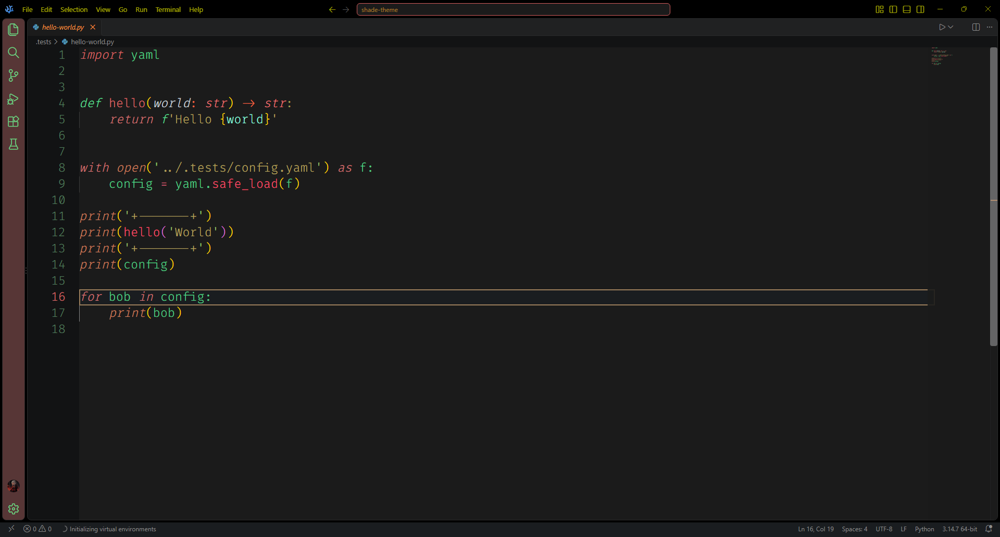
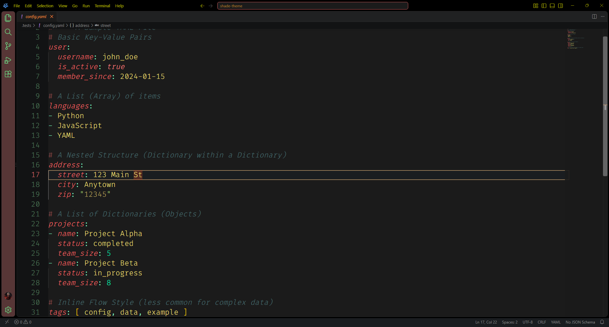
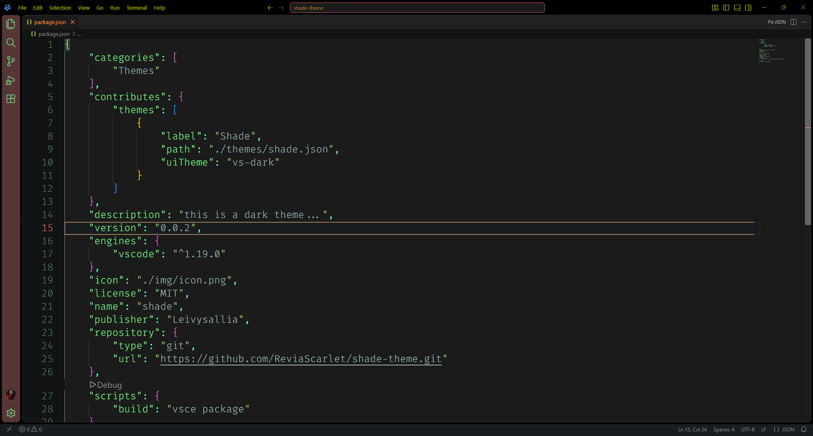
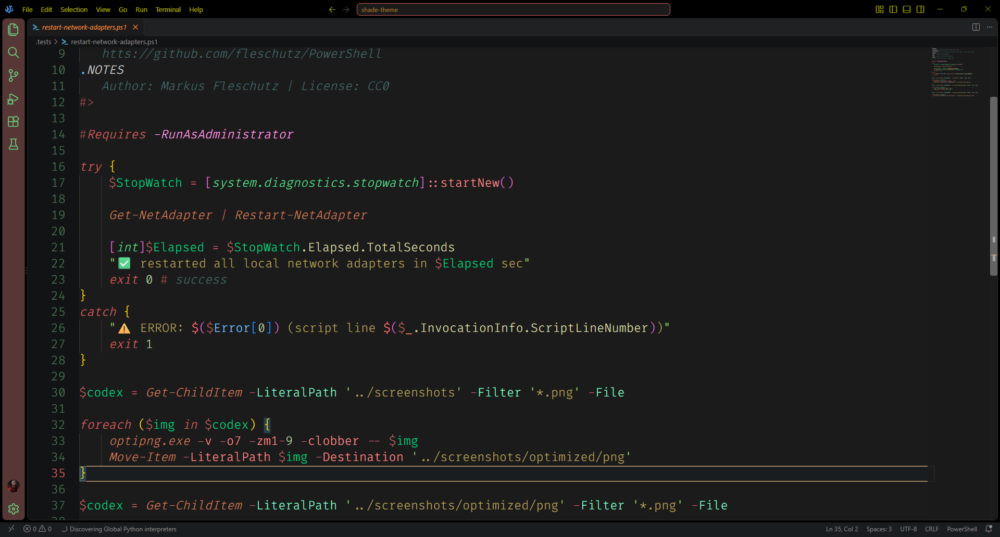
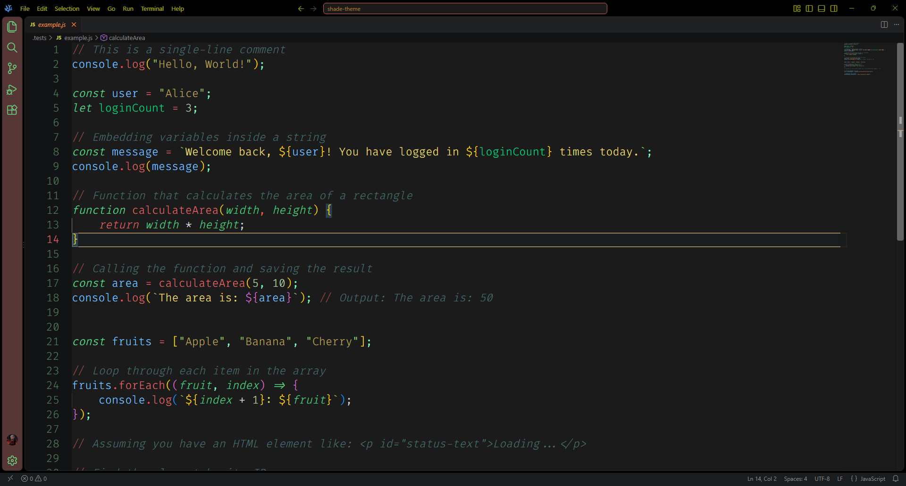
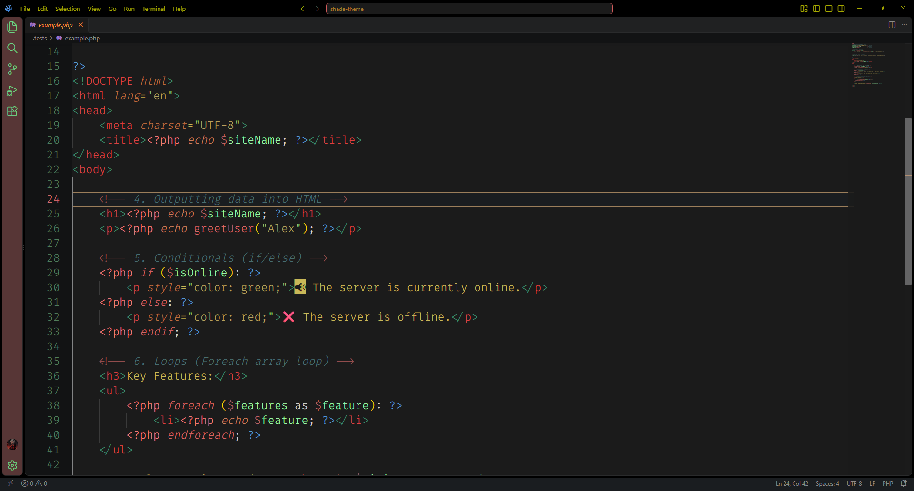
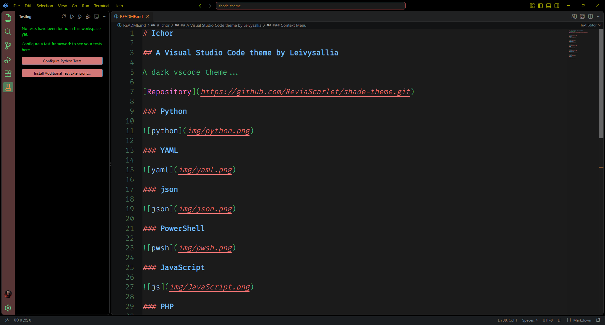
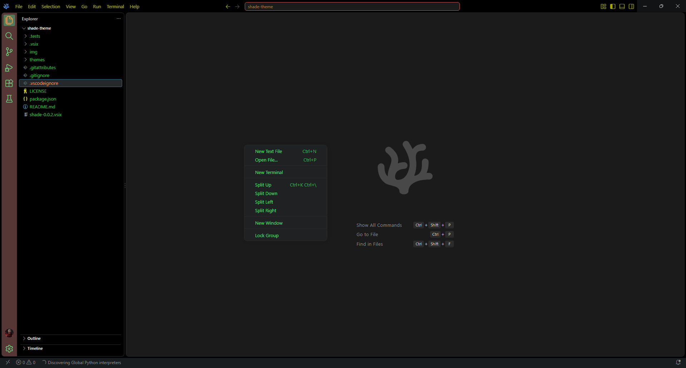
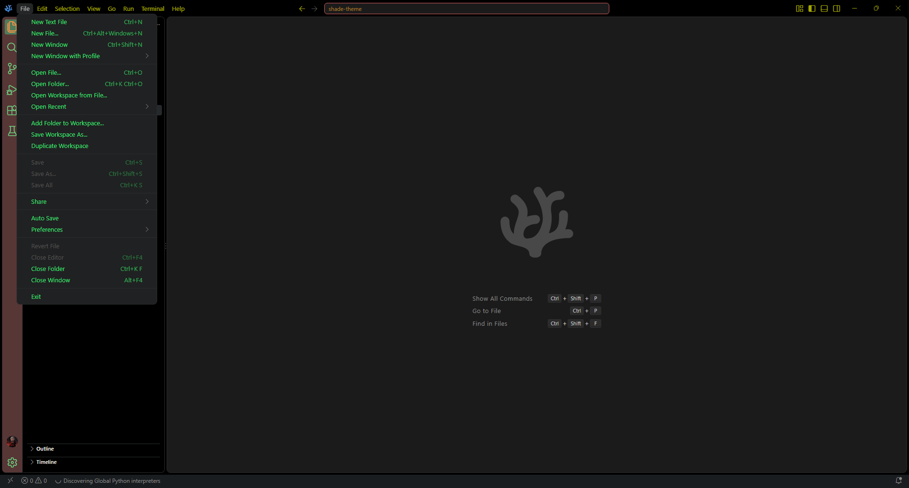
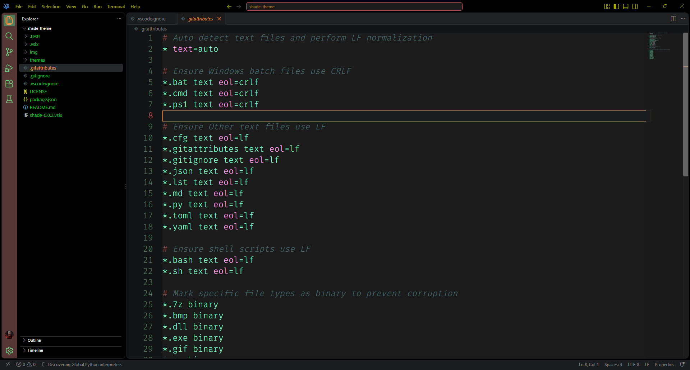

# Shade

## A Visual Studio Code theme by ReviaScarlet [Leivysallia]

Another dark vscode theme...

[Repository](https://github.com/ReviaScarlet/shade-theme.git)

### Python

### YAML

### json

### PowerShell

### JavaScript

### PHP

### Button

### Context Menu

### Menus

### Dotfiles

